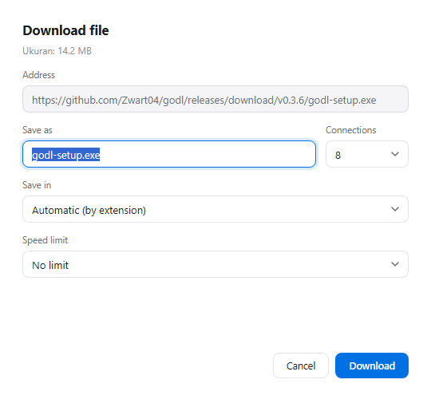

<p align="center">
  
</p>

<h1 align="center">godl</h1>

<p align="center">
  <b>Download manager dengan koneksi paralel untuk Windows.</b><br>
  Unduhan lebih cepat, penangkapan link dari browser, dan tampilan native
  yang tidak mengganggu pekerjaan lain.
</p>

<p align="center">
  <a href="README.md">English</a> · <b>Bahasa Indonesia</b>
</p>

<p align="center">
  <a href="https://github.com/Zwart04/godl/releases/latest"></a>
  <a href="https://tako.id/Zwart04"></a>
</p>

<p align="center">
  <a href="#mulai-cepat">Mulai cepat</a> ·
  <a href="#persyaratan">Persyaratan</a> ·
  <a href="#cara-memakai">Cara memakai</a> ·
  <a href="#keamanan-dan-privasi">Keamanan</a> ·
  <a href="#jika-ada-masalah">Jika ada masalah</a> ·
  <a href="#dukungan">Dukungan</a>
</p>

---

<p align="center">
  
  <br>
  <sub>Contoh tampilan dengan data sampel. godl berjalan di Windows 11.</sub>
</p>

godl membagi satu file menjadi beberapa bagian dan mengunduhnya lewat
beberapa koneksi HTTP sekaligus. Jika server tidak mendukung pembagian seperti
itu, godl otomatis kembali ke satu koneksi. Unduhan bisa dijeda, dilanjutkan,
atau dijadwalkan, dan riwayatnya tersimpan di komputer sendiri.

Panduan ini untuk pengguna. Detail teknis, API, dan catatan pengembangan ada di
[README versi Inggris](README.md).

## Mulai cepat

**Yang perlu disiapkan:** Windows 10 atau 11 (64-bit). godl dipasang untuk
pengguna saat ini dan tidak memerlukan hak administrator, Go, Node.js, atau npm.

> **Catatan Windows 10:** godl memakai runtime Microsoft Edge WebView2. Windows
> 11 sudah menyertakannya, dan sebagian besar Windows 10 juga sudah memilikinya
> lewat Edge. Jika jendela godl kosong atau tidak terbuka, pasang
> [WebView2 Evergreen Runtime](https://developer.microsoft.com/microsoft-edge/webview2/consumer/).

### 1. Unduh installer

Unduh **[`godl-setup.exe`](https://github.com/Zwart04/godl/releases/latest/download/godl-setup.exe)**
dari [rilis terbaru](https://github.com/Zwart04/godl/releases/latest). Ukurannya
satu file, sekitar 14 MB. Kode sumber untuk setiap rilis tersedia di repositori
ini.

### 2. Jalankan installer

Jalankan `godl-setup.exe`. Installer menyalin program ke
`%LOCALAPPDATA%\Programs\godl`, membuat shortcut Start Menu dan desktop,
mendaftarkan dukungan browser, menambahkan godl ke startup Windows, lalu
membuka aplikasinya.

> **Jika Windows menampilkan “Windows protected your PC”:** installer belum
> ditandatangani secara digital, jadi SmartScreen bisa memberi peringatan untuk
> program baru yang belum memiliki sertifikat. Pilih **More info → Run anyway**
> hanya untuk file yang kamu unduh dari repositori ini. Kalau tidak nyaman
> melewati peringatan, [bangun dari kode sumber](#membangun-dari-kode-sumber)
> atau [verifikasi checksum](#verifikasi-unduhan) terlebih dahulu.

Installer ini sengaja dibuat kecil. Ia tidak memasang service, driver, atau
runtime tambahan; antarmuka godl memakai Microsoft WebView2. Untuk memilih
folder lain, melewati autostart, atau uninstall, lihat
[opsi instalasi di README Inggris](README.md#install-options).

### 3. Buka godl

Buka **godl** dari Start Menu jika installer belum membukanya. Jendela godl
adalah seluruh antarmukanya. Menutup jendela tidak mematikan godl: aplikasi
tetap berjalan di notification area (area ikon di kanan taskbar). Untuk benar-
benar berhenti, klik ikon tray lalu pilih **Exit**.

File hasil unduhan masuk ke `Downloads\godl`, diurutkan ke folder kategori.
Riwayat dan pengaturan disimpan di `%APPDATA%\godl`.

### 4. Hubungkan Brave (disarankan)

Installer sudah menyiapkan file ekstensi dan jembatan browser. Kamu hanya perlu
memuat ekstensinya satu kali:

1. Buka `brave://extensions`.
2. Aktifkan **Developer mode**.
3. Klik **Load unpacked**.
4. Pilih `%LOCALAPPDATA%\Programs\godl\extension\chrome`.
5. Pin **godl** ke toolbar.

Chrome dan Edge memakai folder yang sama, lewat `chrome://extensions` atau
`edge://extensions`. Firefox memakai folder terpisah; lihat
[bagian ekstensi di README Inggris](README.md#browser-extension).

### 5. Coba unduhan pertama

Di Brave, klik link unduhan seperti biasa. godl akan membuka dialog kecil berisi
nama file, folder, ukuran, dan jumlah koneksi. Ubah jika perlu, lalu tekan
**Download**. Transfer berjalan di godl dan file disimpan di `Downloads\godl`.

Bisa juga tekan **Add** di godl (`Ctrl`+`N`), lalu tempel link file `http` atau
`https` langsung. Mulai dengan 8 koneksi; godl otomatis memakai satu koneksi
jika server tidak mendukung unduhan terbagi.

<p align="center">
  
  <br>
  <sub>Dialog konfirmasi dari browser. File baru diunduh setelah tombol Download ditekan.</sub>
</p>

Link yang baru disalin atau dikirim dari browser tidak langsung diunduh. godl
menampilkan konfirmasi lebih dulu.

## Persyaratan

| Kebutuhan | Keterangan |
| --- | --- |
| Windows | Windows 10 atau 11, 64-bit |
| WebView2 | Sudah ada di Windows 11; Windows 10 bisa memakai versi yang terpasang bersama Edge |
| Browser | Brave, Chrome, Edge, atau Firefox untuk fitur penangkapan link |
| Hak akses | Tidak perlu administrator untuk instalasi normal |
| Untuk memakai | Tidak perlu Go, Node.js, atau npm |

## Cara memakai

| Tombol | Fungsi |
| --- | --- |
| **Add** | Menambah unduhan dari link langsung. Pintasan `Ctrl`+`N`. |
| **Pause / Resume** | Menghentikan sementara dan melanjutkan dari posisi terakhir. |
| **Stop** | Membatalkan transfer dan menghapus file sementara. |
| **Limit** | Membatasi kecepatan unduhan yang dipilih. |
| **Schedule** | Menentukan kapan unduhan boleh mulai. |
| **Category** | Memindahkan file ke folder kategori lain. |
| **Folder** | Membuka Explorer dengan file hasil unduhan dipilih. |
| **Delete** | Menghapus catatan unduhan dari daftar. |

Menutup jendela membuat godl tetap berjalan di tray. Jika ada transfer aktif,
godl akan bertanya lebih dulu; transfer dijeda dengan progres tetap tersimpan.
Unduhan yang antre dilanjutkan saat godl dibuka lagi.

## Keamanan dan privasi

godl adalah program lokal. Tidak ada akun, layanan cloud, telemetry, analytics,
atau auto-update. Koneksi internet hanya dipakai untuk mengunduh file yang kamu
minta, ditambah komunikasi lokal antara browser dan godl di komputer yang sama.

### API lokal tidak terbuka ke jaringan

- Server kontrol godl hanya mendengarkan di `127.0.0.1` (loopback), dengan port
  acak. Alamat ini tidak bisa diakses dari komputer lain di jaringan.
- Setiap permintaan API memakai token acak yang dibuat saat pertama kali
  dijalankan dan disimpan di `%APPDATA%\godl\api-token`.
- Jangan meneruskan (port-forward) alamat API ini ke internet.

### Data yang disimpan

| Lokasi | Isi |
| --- | --- |
| `%LOCALAPPDATA%\Programs\godl` | Program dan file ekstensi |
| `%APPDATA%\godl` | Riwayat unduhan, token API, pengaturan kategori |
| `Downloads\godl` | File hasil unduhan, diurutkan per kategori |

Installer juga membuat shortcut, menambahkan entri startup, dan menulis
pendaftaran browser. Uninstall menghapus program, shortcut, entri startup, dan
pendaftaran browser; riwayat serta file unduhan sengaja dibiarkan agar tidak
hilang tanpa persetujuanmu.

### Ekstensi browser

Ekstensi meminta izin `nativeMessaging`, `downloads`, `notifications`,
`cookies`, `storage`, `contextMenus`, dan akses ke semua situs (`<all_urls>`).
Izin semua situs diperlukan karena unduhan bisa berasal dari situs mana pun.
Data yang dipakai hanyalah link yang kamu klik, ditambah cookie, referer, dan
user agent untuk permintaan file itu. Data tersebut dikirim ke godl di komputer
yang sama, bukan ke server pihak ketiga.

Ekstensi dipasang dengan **Load unpacked**, bukan dari Chrome Web Store. Kode
sumbernya terbuka dan bisa diperiksa di folder
[`browser-extension/`](browser-extension). Di Firefox, ekstensi yang belum
ditandatangani bersifat sementara dan hilang setelah Firefox ditutup.

Pemantau clipboard adalah bagian dari aplikasi utama, bukan ekstensi. Fitur ini
hanya membaca clipboard saat godl berjalan, hanya menawarkan alamat `http` atau
`https` yang berdiri sendiri, dan tidak mengunduh tanpa konfirmasi. Jalankan
`godl.exe --no-clipboard` untuk mematikannya.

### Installer dan SmartScreen

`godl-setup.exe` belum ditandatangani secara digital. Karena itu SmartScreen
bisa menampilkan peringatan **Windows protected your PC**. Peringatan ini muncul
karena installer belum ditandatangani dan belum punya reputasi, bukan hasil
pemindaian antivirus. Lewati peringatan hanya untuk file dari
[repositori resmi](https://github.com/Zwart04/godl), dan verifikasi checksum
jika ingin lebih yakin.

#### Verifikasi unduhan

Hitung SHA-256 installer di PowerShell:

```powershell
Get-FileHash .\godl-setup.exe -Algorithm SHA256 | Format-List
```

Bandingkan nilai `Hash` dengan SHA-256 di
[catatan rilis terbaru](https://github.com/Zwart04/godl/releases/latest). Jika
tidak cocok, hapus file dan unduh ulang; jangan dijalankan. Catatan rilis juga
menautkan tag kode sumber yang menghasilkan installer tersebut.

### Membangun dari kode sumber

Kalau tidak ingin memakai file build yang belum ditandatangani, bangun sendiri
dari kode sumber:

```powershell
git clone https://github.com/Zwart04/godl.git
cd godl
.\build-setup.ps1
```

### File unduhan tetap berasal dari internet

godl memastikan transfernya sendiri konsisten, tetapi godl bukan antivirus dan
tidak memindai isi file. Tetap aktifkan Microsoft Defender atau antivirus lain,
dan hanya buka file dari sumber yang dipercaya.

Untuk melaporkan masalah keamanan, ikuti [SECURITY.md](SECURITY.md). Jangan
membuat issue publik untuk kerentanan yang bisa dieksploitasi.

## Jika ada masalah

### Windows memblokir installer

Itu peringatan SmartScreen untuk installer yang belum ditandatangani. Pilih
**More info → Run anyway** hanya setelah memastikan file berasal dari repositori
ini. Kalau ragu, verifikasi SHA-256 atau bangun sendiri dari kode sumber.
Jangan mematikan SmartScreen secara global.

### godl tidak terbuka

- Pastikan Windows 10 atau 11 64-bit.
- Pasang [WebView2 Evergreen Runtime](https://developer.microsoft.com/microsoft-edge/webview2/consumer/)
  jika jendela kosong atau tidak muncul. Windows 11 biasanya sudah punya.
- Periksa notification area. Menutup jendela berarti menyembunyikan godl, bukan
  menghentikannya. Klik dua kali ikon tray untuk membuka lagi.
- Jika salinan lama masih berjalan, keluar dulu lewat tray. godl hanya
  mengizinkan satu manager berjalan di satu komputer.

### Brave masih mengunduh sendiri

1. Buka `brave://extensions`, pastikan **godl** aktif.
2. Buka opsi ekstensi, pastikan **Ask before each download** dan penangkapan
   unduhan aktif.
3. Reload ekstensi setelah memasang atau memperbarui godl.
4. Pastikan jembatan browser masih menunjuk ke folder instalasi. Perintah
   perbaikannya ada di [README Inggris](README.md#browser-extension).
5. Jika godl tidak berjalan, ekstensi sengaja mengembalikan unduhan ke browser
   agar file tidak hilang. Jalankan godl lalu coba lagi.

Langkah yang sama berlaku untuk Chrome dan Edge. Ekstensi sementara Firefox
harus dimuat ulang setiap kali Firefox dibuka.

### Unduhan gagal atau hanya memakai satu koneksi

Sebagian server tidak mendukung HTTP Range, jadi godl otomatis memakai satu
koneksi. Ini normal. Link yang berhasil di browser tetapi gagal di godl mungkin
membutuhkan login, token yang cepat kedaluwarsa, URL sekali pakai, atau situs
yang menolak klien selain browser. Salin ulang link dari halaman aslinya,
pastikan sudah login, atau biarkan browser yang menangani unduhan tersebut.
godl tidak menghapus salinan browser saat handoff gagal.

### Di mana file dan riwayat saya

File hasil unduhan ada di `Downloads\godl`, di dalam folder kategori yang
dipilih. Riwayat, token, dan pengaturan ada di `%APPDATA%\godl`. Program dan
ekstensi ada di `%LOCALAPPDATA%\Programs\godl`.

### Uninstall atau matikan autostart

Jalankan installer dengan `-uninstall`:

```powershell
.\godl-setup.exe -uninstall
```

Perintah ini menghapus program, shortcut, entri startup, dan pendaftaran
browser. Folder `%APPDATA%\godl` dan `Downloads\godl` tetap ada; hapus sendiri
kalau ingin bersih total.

Untuk tetap memakai godl tetapi tidak menjalankannya saat Windows mulai, pakai
`godl-setup.exe -no-autostart`, atau nonaktifkan entri **godl** di Task Manager
→ Startup apps. Keluar dari tray sebelum uninstall.

## Dukungan

godl gratis dan open source dengan lisensi MIT. Kalau proyek ini membantu dan
kamu ingin mendukung pengembangnya, dukungan sukarela bisa diberikan di sini:

<p align="center">
  <a href="https://tako.id/Zwart04"></a>
</p>

Dukungan bersifat opsional. Tidak ada fitur yang dikunci, tidak ada batas
tambahan yang dibuka, dan cara kerja aplikasi tidak berubah. Memberi bintang di
GitHub, membagikan proyek, atau melaporkan bug yang bisa direproduksi juga sangat
membantu.

## Lisensi

[MIT](LICENSE) © Zwart

Dibuat dari awal. Tata letak antarmuka mengambil inspirasi dari download
manager yang sudah ada; tidak ada kode, aset, atau branding dari program lain
yang disertakan.
