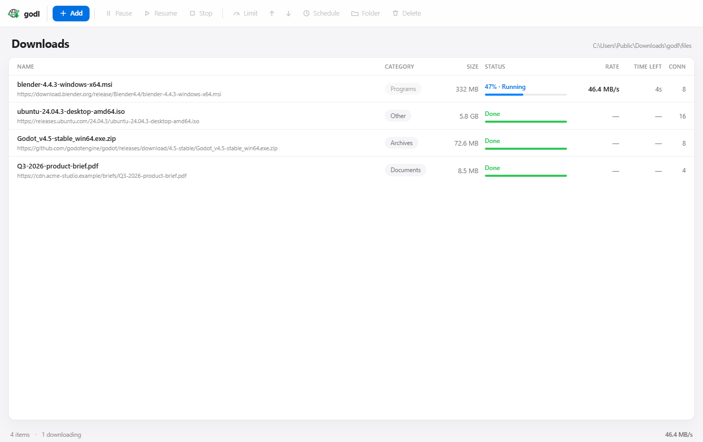

<p align="center">
  
</p>

<h1 align="center">godl</h1>

<p align="center">
  <b>A segmented download manager for Windows.</b><br>
  Multi-connection transfers, automatic browser capture, and a native
  interface that stays out of the way.
</p>

<p align="center">
  
  
  
  
  
</p>

<p align="center">
  <a href="#install">Install</a> ·
  <a href="#using-godl">Using godl</a> ·
  <a href="#browser-extension">Browser extension</a> ·
  <a href="#how-it-works">How it works</a> ·
  <a href="#http-api">HTTP API</a> ·
  <a href="#development">Development</a>
</p>

---



godl splits a file across several HTTP connections at once, so a server that
would only feed one stream is asked for several at the same time. It resumes
across restarts, keeps an honest record of every transfer, and never lets two
copies of itself fight over the same file.

It is written from scratch in Go. Nothing is derived from any existing download
manager's code, assets, or branding — the layout is familiar on purpose, the
implementation is not.

## Features

**Transfer**
- Segmented parallel downloading, 1 to 32 connections per file
- Automatic fallback to a single connection when a server refuses `Range`
  requests — the connection count shown is always the one actually in use
- Pause, resume, retry, and stop, all resumable across restarts
- Queue order you can change: move a download ahead of the one above it and the
  queue starts it next, not merely the row that moved in the window
- A scheduled start, kept on the record so a transfer set for three in the
  morning begins even with the app closed
- Each connection writes its own region of one file, so segments never overlap
  and a finished part is never rewritten

**Reliability**
- One manager per machine. A single-instance lock prevents two schedulers
  from writing the same `.part` file, which is how downloads get corrupted
- Closing the window puts godl in the notification area and keeps downloading.
  **Exit** from the tray icon asks first when transfers are running, then leaves
  them **paused with their progress intact** rather than failed
- Resume continues from the progress already on disk, not from zero, and the
  engine refuses a resume the server will not honour rather than silently
  restarting
- **A pause is a pause.** The scheduler is willing to start a paused record —
  that is what lets a queue drain and what makes one resumable after a restart —
  so it is told apart from a transfer that simply stopped. Nothing restarts a
  download you paused until you ask it to
- A failure waits for you. It is recorded as failed rather than retried behind
  your back, so a host that cannot be reached is not probed again and again for
  as long as the app stays open
- State is persisted on every transition, so a crash costs seconds, not files
- An endpoint left behind by a crashed run is verified with a real
  authenticated health check before being believed

**Filing**
- Seven built-in categories — Programs, Archives, Documents, Music, Video,
  Pictures and a catch-all Other — each with its own folder under the download
  directory
- A new download is filed by its extension the moment the link arrives, so a
  browser's own links need no input at all
- Change a download's category and the file moves with it, into that folder,
  without ever overwriting what is already there. A transfer under way is the
  one exception: its file is open, so the change is refused rather than half
  done
- The list is yours to change. A `categories.json` beside the rest of godl's
  state folds over the built-ins — an entry naming `.iso` makes ISOs a
  category of their own, and one with a new name simply adds it. A file that
  cannot be read falls back to the built-ins, because a settings file must
  never be able to stop downloads landing somewhere
- A category's folder is created when it is needed, including again if you
  tidy it away while downloads still point at it

**Links you copy**
- godl watches the clipboard for an address and asks before fetching anything:
  a dialog with the link in full and two buttons, and nothing is downloaded
  until one of them is pressed. Copying a URL never starts a transfer by itself
- Only a bare `http` or `https` address that makes up the whole of what was
  copied is offered. A sentence with a link in the middle is prose, and prose is
  not a file
- One copy is one offer. The next one is offered when you copy something else,
  and a link already in the list is not offered at all
- If the attempt fails, the link stays on offer rather than disappearing with
  the error - a server that could not be reached should not cost you the address
  as well as the attempt
- Reads the clipboard through Windows itself, from the process already running:
  no helper, no injection, and it is opened only for as long as the read takes
  so other programs are never held up by it
- On by default in the window, off in `--serve` unless started with
  `--clipboard`, and `godl.exe --no-clipboard` turns it off for good

**Interface**
- A native desktop window, not a browser tab: its own process, its own taskbar
  entry, its own line in Task Manager
- **A system tray icon that stays.** Closing the window hides it; double-click
  the icon or choose **Open godl** to bring it back, and **Exit** to stop the
  manager. godl keeps running and downloading while hidden
- IDM-style columnar list — name, category, size, status, speed, time left,
  connections
- **A transfer window of its own, per download.** It opens when a transfer
  starts with the address, the file size, what has arrived, the rate, the time
  left and whether it can resume; a progress bar underneath, and below that the
  map of which connection owns which part of the file with a row per connection
  saying whether it is receiving, waiting or done. Pause, Cancel and *Hide
  details* (which collapses the map and the table, and grows back to exactly
  the height it had), plus tabs for what happens when the transfer finishes and
  for a speed limit. It closes itself when the download does, and double-clicking
  a row brings it back
- Sortable columns, in-place row updates, keyboard shortcuts
- Apple-inspired visual design: hairline rules, one accent colour, no chrome
  that is not doing work

**Browser**
- Extension for Chrome, Brave, Edge and Firefox
- Catches downloads and hands them to godl with the page's cookies, referer
  and user agent, so a server that said yes to the browser says yes to godl
- **Opens the download dialog first**, with the name, the folder, the size and
  the connection count, and waits for you — *Start*, change anything, or *not
  now*. A single switch in the extension's options turns the asking off
- Gives the download straight back to the browser if godl is unavailable —
  nothing is ever lost by trying
- A desktop notification confirms a successful handoff, and says so when godl
  cannot take the link and the browser keeps the download

**After a download**
- Files land in your own `Downloads\godl` folder, sorted into category folders
  underneath — not inside a profile directory you would have to go looking for
- A balloon from Windows names the file and the folder it landed in. The
  browser's own row is already gone by then, and a window behind four others
  is not an announcement

**Footprint**
- **One setup file.** `godl-setup.exe` carries everything, installs it, wires
  the browser, and launches the app — there is no second file to place by hand
- No installer framework, no runtime to install, no background service
- No Node.js, no npm, no bundler — the web interface is three hand-written
  files served by the manager's own handler
- About 14 MB for the setup, roughly 22 MB once installed

## Install

Grab **[`godl-setup.exe`](https://github.com/Zwart04/godl/releases/latest)**
and run it. That is the entire installation.

It copies `godl.exe`, `godl-host.exe` and the browser extension into
`%LOCALAPPDATA%\Programs\godl`, creates Start Menu and desktop shortcuts,
registers itself with Chrome, Brave, Edge and Firefox, adds itself to Windows
startup, and opens the app. The extension lands in
`%LOCALAPPDATA%\Programs\godl\extension\chrome` (and `…\firefox`), which is the
folder to pick when the browser asks for one.

You never need to place the second program yourself: `godl-host.exe` is the
file your *browser* launches when a download link is clicked, and the setup
puts it where the browser has already been told to find it.

```powershell
.\godl-setup.exe                          # install and start
.\godl-setup.exe -quiet                   # install without the dialog
.\godl-setup.exe -dir "D:\Tools\godl"     # install somewhere else
.\godl-setup.exe -uninstall                # remove it completely
.\godl-setup.exe -no-autostart             # install, but not with Windows
.\godl-setup.exe -no-desktop               # install, but no desktop icon
```

Uninstalling removes the programs, the shortcuts, the startup entry and all
four browser registrations. Your download history in `%APPDATA%\godl` and your
files in `Downloads\godl` are left alone unless you delete them yourself.

### Building it from source

```powershell
git clone https://github.com/Zwart04/godl.git
cd godl

.\build-setup.ps1          # -> godl-setup.exe
```

The script builds both programs, packs them, and embeds them into one windowed
executable. If you only want the programs:

```powershell
bin\wails.exe build                              # -> build\bin\godl.exe
go build -o build\bin\godl-host.exe .\cmd\godl-host
```

## Using godl

Open **godl** from the Start Menu (or the desktop icon the setup created).

| | |
|---|---|
| **Add** | Opens a sheet to paste a URL, name the file, and choose a connection count. <kbd>Ctrl</kbd>+<kbd>N</kbd>. |
| **Pause / Resume** | Stops a transfer where it is, and starts it again where it stopped. Pausing holds: nothing picks the download up until you resume it. Both survive closing the app. |
| **Stop** | Abandons the transfer and discards the partial file. |
| **Limit** | Caps how fast the selected download may transfer, from 128 KB/s up or a figure of your own. It takes effect on the transfer already running, not on the next one. |
| **Arrows** | Move the selected download earlier or later in the queue. The queue starts them in that order. Pressing one drops a column sort, so you see the queue's own order — the one the arrows act on. |
| **Schedule** | Says when this download may begin. A transfer already under way is stopped and held; a paused, failed or discarded one is put back in the queue for that time. An empty box means now, which is how a schedule is cleared. If the transfer finished on its way out, the control says so rather than pretend the file is still to come. |
| **Category chip** | The category in its own column, and the way to change it. Picking another moves the file into that folder's folder. A download running right now has its file open, so its chip is off. |
| **Folder** | Opens Explorer with the finished file selected. |
| **Delete** | Removes the record. |
| **Close the window** | If transfers are running, you are asked first. In-flight ones are paused; queued ones start again on the next launch. |

**A link you copy.** Copy a bare `http` or `https` address and a sheet appears
with it in full and two buttons: **Download** puts it in the list through the
same path **Add** uses, and **Not now** puts it down. Nothing is fetched until
you choose; a copy on its own never starts a transfer. Text that merely
mentions a link is ignored, as is anything already in the list.

State lives in `%APPDATA%\godl`; finished files land in your own
`Downloads\godl`. Setting `GODL_HOME` redirects both — which is how the test
suite runs against a scratch directory, and why a test run never drops a file
into your real Downloads folder or rewrites your browser's registration.

## Browser extension

The extension lives in [`browser-extension/`](browser-extension). Chrome, Edge
and Brave use `browser-extension/chrome`; Firefox uses
`browser-extension/firefox`. The logic in both is byte-identical — only the
manifest differs. Brave reads Chromium's registration, which godl writes as
well as Chrome's, so one folder covers all three.

**1. Register the native messaging host** — the setup does this for you, and
`godl.exe` does it again on every launch so moving the folder never breaks it.
(The exception is a run started with `GODL_HOME` set: such a run is a test or a
throwaway copy, and the browser table belongs to the machine rather than to
it.) These two commands are only for repairing it by hand:

```powershell
& "$env:LOCALAPPDATA\Programs\godl\godl.exe" --register-browser   # rewrites the keys
& "$env:LOCALAPPDATA\Programs\godl\godl.exe" --unregister-browser # removes them
```

**Switches** — every one of them optional, and every one on the same binary:

| Switch | What it does |
| --- | --- |
| `--register-browser` | Writes the Chrome, Brave, Edge and Firefox keys |
| `--unregister-browser` | Removes them |
| `--serve` | Runs the same engine with no window; <kbd>Ctrl</kbd>+<kbd>C</kbd> stops it |
| `--clipboard` | With `--serve`, watches the clipboard the way the window does |
| `--no-clipboard` | Turns the watcher off for the window |

**2. Load the extension**

- **Chrome / Edge / Brave** — open `chrome://extensions` (Brave:
  `brave://extensions`), turn on *Developer mode*, choose *Load unpacked*, and
  pick `%LOCALAPPDATA%\Programs\godl\extension\chrome` (from a source checkout
  that is `browser-extension/chrome`). A desktop notification confirms each
  successful handoff; reload the extension once after upgrading so the browser
  picks up the `notifications` permission.
- **Firefox** — open `about:debugging#/runtime/this-firefox`, choose
  *Load Temporary Add-on…*, and pick `browser-extension/firefox/manifest.json`.

**3. Use it.** Click any download link. godl captures it, brings its window to
the front and asks what to do with it: the name, the folder, the size, the
connection count, and a *Download* button. Change any of it, press *not now*,
or leave it and the transfer begins where you said. If the app was not open,
it is launched for you.

The asking is a switch in the extension's options — *Ask before each download*.
Turned off, transfers start the moment a link is clicked, the way a browser
does it, only across eight connections instead of one.

Right-click → *Download with godl* is available as a manual route whenever
automatic capture is switched off in the extension's options. The options page
also lets you limit capture to particular file types and set the connection
count.

## How it works

```
   browser ──stdio──▶ godl-host.exe ──HTTP──▶ ┌────────────────────────┐
                                              │       godl.exe        │
   double-click ─────────────────────────────▶│                        │
                                              │  queue  ─▶  engine    │
                                              │  api    ─▶  state     │
                                              └────────────────────────┘
                                                        │
                                                        ▼
                                                  files on disk
```

The browser cannot hand a file to a download manager by itself. It launches a
small helper — a *native messaging host* — listed in a per-user registry key
that points at a manifest on disk. `godl-host.exe` is that helper: it speaks
the browser's framing on stdin/stdout, and godl's local HTTP API on the other
side.

If no manager is running when a link is clicked, `godl-host.exe` launches
`godl.exe` and waits for it. The download proceeds either way.

The desktop window is not a separate program. It is `godl.exe` showing
WebView2 against the *same* control API the browser host uses — one queue, one
token, one place where a button can be wrong.

| Package | Responsibility |
|---|---|
| `internal/engine` | Segmented transfer, range planning, speed accounting, SHA-256 verification |
| `internal/queue` | Scheduling, concurrency limits, status transitions |
| `internal/category` | Category list, extension rules, folder names kept inside the download directory |
| `internal/clipboard` | Reading the clipboard for a link worth offering, and deciding what counts as one |
| `internal/state` | On-disk records, atomic writes, recovery on start |
| `internal/api` | The loopback HTTP control plane and the served interface |
| `internal/host` | The native messaging protocol and its client |
| `internal/nmh` | Native messaging frame encoding — 4-byte length prefix, JSON body |
| `internal/browsersetup` | The three registry keys and two manifests |
| `internal/app` | Assembling a manager, the single-instance lock, startup and shutdown |

## HTTP API

A bearer token is created on first run and stored at
`%APPDATA%\godl\api-token`. Every request needs it. The server binds to
`127.0.0.1` only — it is never reachable from the network.

| Method | Path | |
|---|---|---|
| `GET` | `/api/health` | Liveness check |
| `GET` | `/api/downloads` | Every record with live progress |
| `GET` | `/api/categories` | The categories in force, in the order they are shown |
| `GET` | `/api/clipboard` | The copied link waiting for an answer, if any |
| `POST` | `/api/clipboard/accept` | Download the waiting link, through the ordinary add path |
| `POST` | `/api/clipboard/ignore` | Put the waiting link down |
| `GET` | `/api/captures` | The downloads the browser handed over and nobody has answered, oldest first |
| `POST` | `/api/captures` | Hand one over without starting it — the browser's route |
| `POST` | `/api/captures/{id}/accept` | Start it, applying whatever the dialog changed |
| `POST` | `/api/captures/{id}/ignore` | Put it down without downloading |
| `POST` | `/api/downloads` | Add a download |
| `POST` | `/api/downloads/{id}/pause` | Pause |
| `POST` | `/api/downloads/{id}/resume` | Resume |
| `POST` | `/api/downloads/{id}/retry` | Retry after a failure |
| `POST` | `/api/downloads/{id}/cancel` | Stop and discard the partial file |
| `POST` | `/api/downloads/{id}/speed-limit` | Cap this download, or clear the cap with `0` |
| `POST` | `/api/downloads/{id}/schedule` | Say when this download may begin, or clear the schedule with an empty `starts_at` |
| `POST` | `/api/downloads/{id}/move-up` | Move ahead of the download above it |
| `POST` | `/api/downloads/{id}/move-down` | Move behind the download below it |
| `POST` | `/api/downloads/{id}/category` | Put it in another category, moving its file |
| `POST` | `/api/downloads/{id}/reveal` | Show in Explorer |
| `POST` | `/api/downloads/{id}/status` | Open this download's transfer window (`204` when there is no window to show) |
| `DELETE` | `/api/downloads/{id}` | Remove the record |

```jsonc
// POST /api/downloads
{
  "url": "https://example.com/large.iso",
  "filename": "large.iso",       // optional; derived from the URL if absent
  "connections": 8,              // 1-32
  "speed_limit": 0,              // bytes per second; 0 means no cap
  "category": "Programs",        // optional; the extension decides if absent
  "cookie": "session=…",         // forwarded verbatim
  "referer": "https://…",        // forwarded verbatim
  "user_agent": "…"              // forwarded verbatim
}
```

`speed-limit` takes the same field and is accepted in any state — including one
that is transferring right now, which is the reason it exists:

```jsonc
// POST /api/downloads/0f3c1a9b7d2e4c5a/speed-limit
{ "speed_limit": 1048576 }       // 1 MB/s; 0 removes the cap
```

`schedule` takes an RFC 3339 instant, or an empty string to mean "now", which
is how a schedule is cleared:

```jsonc
// POST /api/downloads/0f3c1a9b7d2e4c5a/schedule
{ "starts_at": "2026-10-20T03:00:00Z" }
```

It is accepted everywhere but a finished download, and it puts the record back
in the queue — a time only means something to a transfer the queue is willing
to start. A download already under way is stopped first, with its progress
kept, because it has already begun and the only honest reading of "start it at
nine" is "stop it now, start it at nine". `resume` and `retry` drop the
schedule, since being told to go now is a newer answer to *when?* than the one
on the record.

Stopped is not the same as unfinished. A transfer on its way out can still
reach the end — the bytes are whole and the part file has been published — and
then there is nothing left to hold. Every control shares one rule in that
case: `409` with *"this download finished before the change could be applied"*,
and the record left `done`. Writing `queued`, `paused` or `cancelled` beside a
file that has already arrived would have the window waiting on a clock for a
download with no first byte left to wait for.

`move-up` and `move-down` swap places with a neighbour and are answered against
queue order — the order the list shows unless a column sort is over it. Off
either end they return `409`, which describes the list rather than a fault.

`category` takes a name from `/api/categories`, and an unknown one is answered
with the list it was checked against rather than a bare refusal:

```jsonc
// POST /api/downloads/0f3c1a9b7d2e4c5a/category
{ "category": "Music" }
```

The file moves with it. It is refused with `409` while the download is
transferring, because the worker holds the file open and Windows will not
rename one that is — saying so beats half-moving a transfer that is under way.

The categories themselves are the seven built-ins, folded over by a
`categories.json` kept beside the rest of godl's state (`%APPDATA%\godl`, or
`GODL_HOME` if you pointed it somewhere):

```json
[
  { "name": "ISOs", "folder": "Disc Images", "extensions": ["iso", "img"] },
  { "name": "Music", "extensions": ["mp3", "flac"] }
]
```

Only what you want changed needs to be in that file: an entry whose name
already exists replaces it, and one with a new name is added. Extensions are
claimed by the entry that names them last, so adding `ISOs` above takes `.iso`
away from Programs rather than being quietly ignored. A folder is a single
directory name — anything looking like a path is rejected, so no entry can put
a download outside the folder you chose. A file that cannot be read falls back
to the built-ins.

Progress is reported as:

```jsonc
{
  "id": "0f3c1a9b7d2e4c5a",
  "status": "running",
  "segmented": true,
  "connections": 8,
  "speed_limit": 1048576,
  "starts_at": "2026-10-20T03:00:00Z",   // absent unless scheduled
  "total_size": 33554432,
  "progress": { "done": 16777216, "total": 33554432, "percent": 50.0, "speed": 4123568.0 }
}
```

## Development

```powershell
$env:PATH = "C:\Program Files\Go\bin;" + $env:PATH   # if Go is not on PATH

gofmt -l .                     # must print nothing
go vet ./...                   # must exit 0
go test -count=3 -shuffle=on ./...

# The race detector needs cgo, and cgo needs a C compiler on PATH - MinGW-w64
# does the job. It can then be built into the program itself with
# `wails build -race`, and the suite below runs that binary end to end.
go test -race -count=1 ./...

# The installer is behind a build tag, so the checks above skip it by
# design; check it separately once a payload exists.
.\build-setup.ps1
go vet -tags setup ./cmd/godl-setup
```

### End-to-end verification

Two scripts exercise the built programs rather than the source. Both clean up
after themselves even when a check fails, so one red run cannot poison the
next.

```powershell
.\scripts\smoke.ps1            # launch, auth, transfer, filing, clipboard, shutdown
.\scripts\test-installer.ps1   # install, shortcuts, registration, uninstall
```

`smoke.ps1` starts the real `godl.exe` with `GODL_HOME` pointed at a scratch
directory, transfers 32 MB from a local range-supporting server, and checks
that the file arrives byte-for-byte, that it is filed under its category, that
a link copied to the clipboard is only ever offered, that a second launch is
refused rather than becoming a second scheduler, and that closing the window
releases the single-instance lock. It puts the clipboard back afterwards.

`GODL_SMOKE_EXE` points that same suite at another binary, which is how a
race-enabled build is checked - `wails build -race`, giving the detector real
concurrent transfers instead of only the unit tests. A windowed program has
no console to write to, so the suite captures the manager's stderr to a file
and fails at the end if the detector ever found something.

Unit tests cover segment planning, resume and restart, concurrency limits,
state recovery, the HTTP control API, categories and folder rules, the
clipboard watcher, the native messaging protocol, and browser registration.

Set `GODL_HOME` to a scratch directory to run against a throwaway
configuration:

```powershell
$env:GODL_HOME = "$env:TEMP\godl-dev"
& "$env:LOCALAPPDATA\Programs\godl\godl.exe"
```

### Project layout

Every executable is built, never committed — `build-setup.ps1` produces them
from the source below.

```
godl/
├─ main.go                     the window: size, close confirmation, flags
├─ notify_windows.go           message boxes (a GUI app has no console)
├─ build-setup.ps1             builds both programs and packs the setup
├─ cmd/
│  ├─ godl-setup/              installer: extracts, registers, shortcuts
│  └─ godl-host/               the browser's native messaging host
├─ internal/
│  ├─ api/                     control API + web/ (index.html, app.css, app.js)
│  ├─ app/                     manager assembly, single-instance lock
│  ├─ browsersetup/            registry keys and manifests
│  ├─ config/                  directories, token, endpoint file
│  ├─ engine/                  segmented transfer
│  ├─ host/                    native messaging client
│  ├─ nmh/                     native messaging framing
│  ├─ notify/                  the balloon Windows shows when a download ends
│  ├─ queue/                   scheduler
│  └─ state/                   on-disk records
├─ browser-extension/
│  ├─ chrome/                  Chrome and Edge
│  └─ firefox/                 Firefox (identical logic)
├─ scripts/                    end-to-end verification
├─ build/
│  ├─ appicon.png              icon source
│  ├─ bin/                     build outputs (gitignored)
│  └─ windows/                 icon.ico and the Windows manifest
└─ docs/                       logo and screenshots
```

## Roadmap

- [x] Segmented parallel transfer with automatic single-connection fallback
- [x] Pause, resume, retry, stop — all surviving restart
- [x] Single-instance guarantee and graceful shutdown
- [x] Native desktop window
- [x] Local HTTP control API with token auth
- [x] Native messaging host with automatic manager startup
- [x] Browser extension for Chrome, Brave, Edge and Firefox
- [x] Single-file setup with install, shortcuts and uninstall
- [x] Per-download speed limit, set when adding or moved while a transfer runs
- [x] Queue ordering and a scheduled start
- [x] Download categories and folder rules
- [x] Clipboard monitor for copied links
- [x] Downloads land in your own `Downloads\godl`, with a Windows balloon naming
  the file and the folder when a transfer ends
- [x] A run redirected by `GODL_HOME` cannot touch the machine's browser
  registration
- [x] The download dialog a browser capture opens — name, folder, size and
  connection count before anything starts, with a switch to stop asking
- [x] The transfer window — a native, per-download window showing URL, size,
  received, rate, time left and resume, with the progress bar, the map of which
  connection owns which part of the file, the per-connection table, and
  pause/cancel/hide details that collapse it back to its exact height

## License

[MIT](LICENSE) © Zwart

Written from scratch. The interface layout takes inspiration from established
download managers; no code, artwork, or branding from any of them is included.
